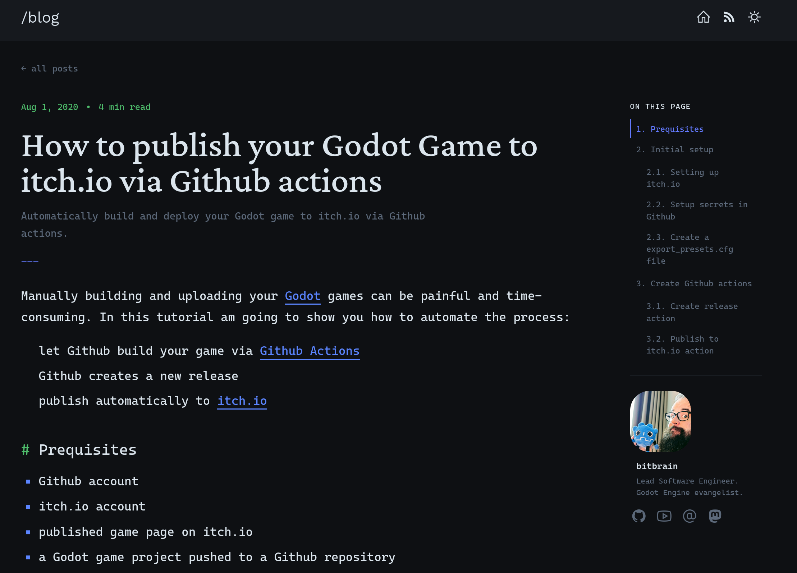

# Zola Dash
Minimal theme for [Zola](https://www.getzola.org/), powered by
[TailwindCSS](https://tailwindcss.com/). Color palette adapted from
[Jekyll Dash](https://github.com/bitbrain/jekyll-dash).

### Demo
Demo coming soon



### Setup
In your zola site directory
- Get theme

    ```shell
    git submodule add https://github.com/your-org/zola-dash themes/zola-dash
    ```

- Build CSS

    ```shell
    cd themes/zola-dash
    yarn install --frozen-lockfile
    yarn build
    ```

- Configure syntax highlighting for Zola 0.22+ if your site overrides the
  theme's Markdown config.

    ```toml
    [markdown.highlighting]
    theme = "dash"
    extra_themes = ["themes/zola-dash/syntax_themes/dash.json"]
    error_on_missing_language = true
    ```

- Change theme specific variables. They are listed in the `extra` section of
  `config.toml`.

### Colors
This theme uses the Jekyll Dash color palette for both light and dark modes.
If you want to customize, adjust the color values in `tailwind.config.js` under
`theme.extend.colors`, or override via your site Tailwind setup.

The bundled `dash` syntax highlighting theme lives in
`syntax_themes/dash.json` and is loaded through Zola's Giallo-based
`[markdown.highlighting]` configuration.

Refer [Zola Docs](https://www.getzola.org/documentation/themes/installing-and-using-themes/#using-a-theme)
for further instructions

### Credits & License
- Original Zola theme: [Boring](https://github.com/ssiyad/boring) by Sabu Siyad (GPLv3)
- Color palette: [Jekyll Dash](https://github.com/bitbrain/jekyll-dash) by bitbrain (Apache-2.0)

[GPLv3](./LICENSE)

